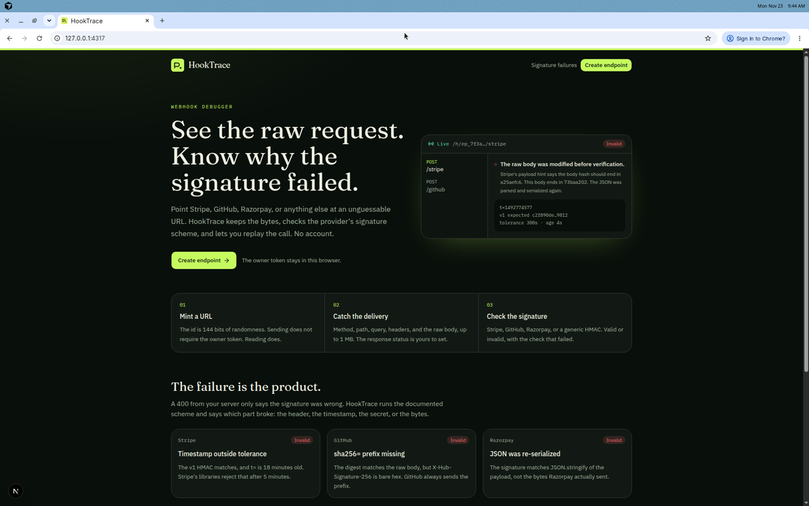
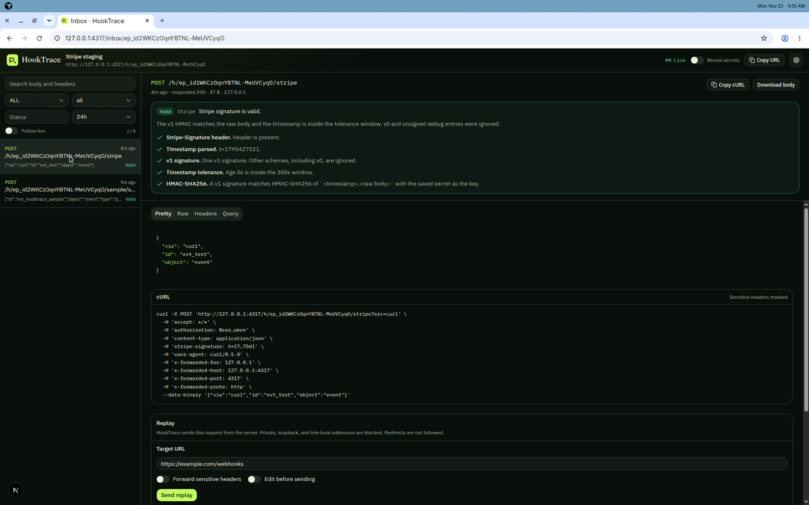
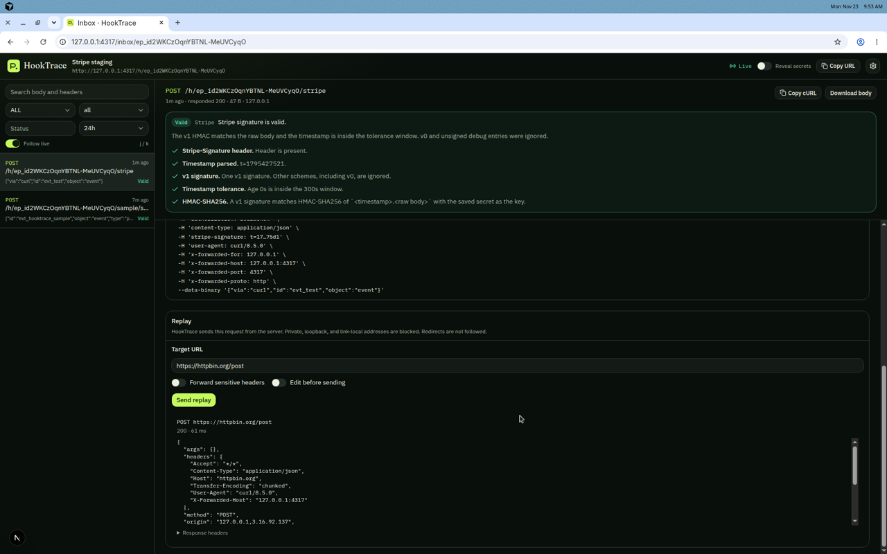
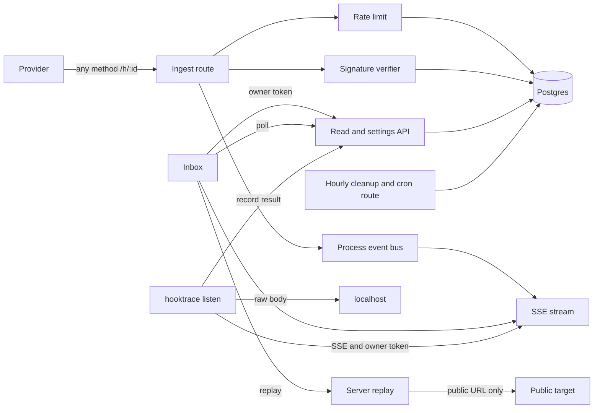
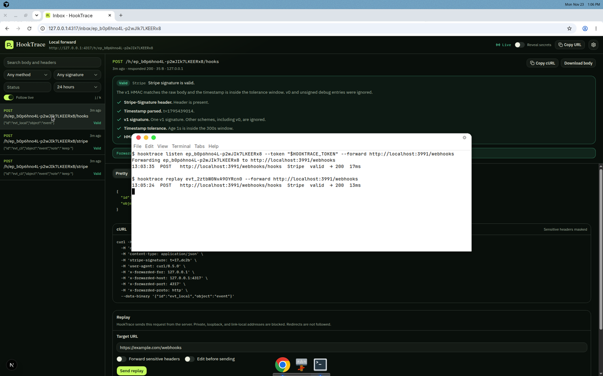
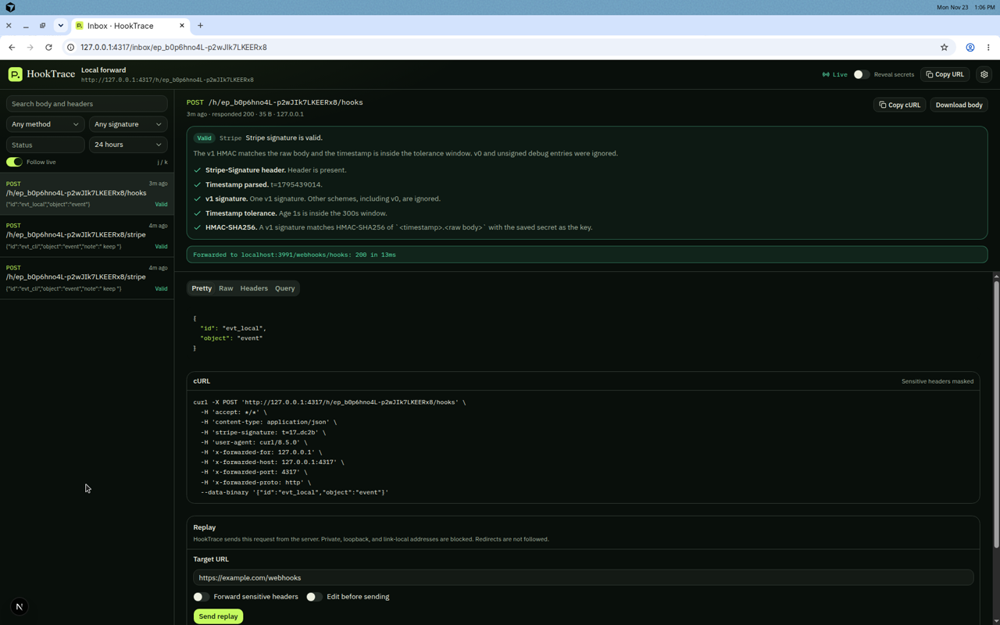
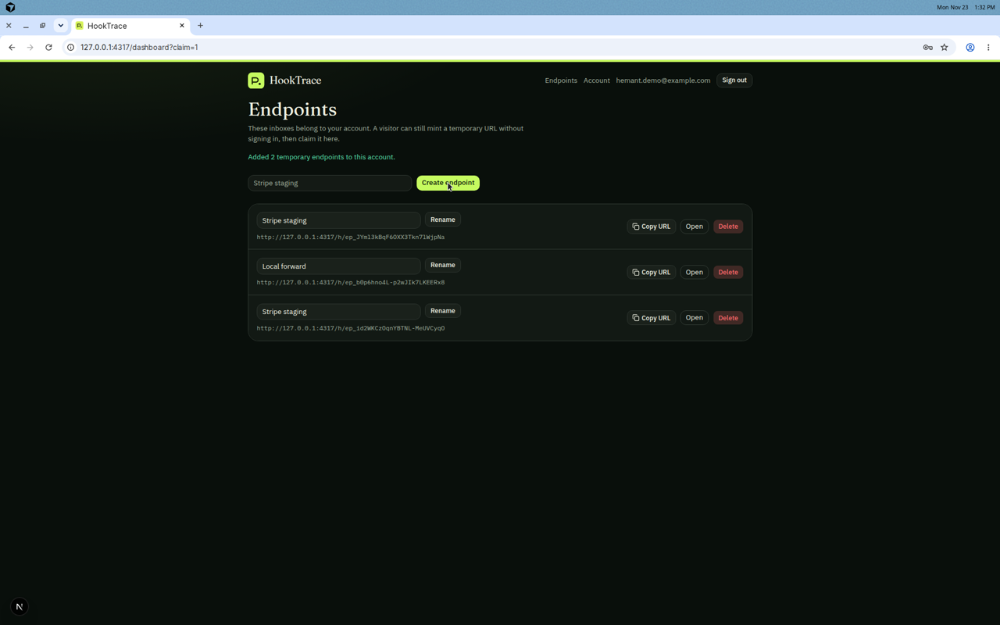
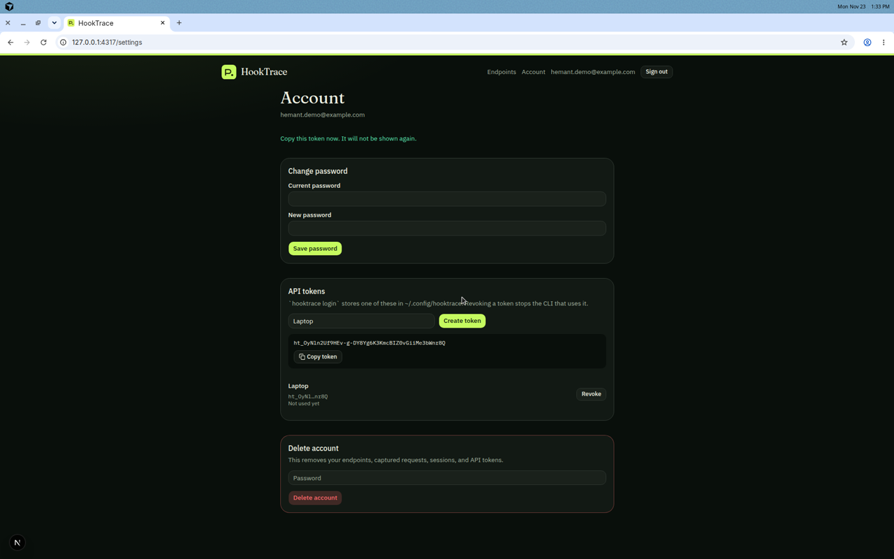

# HookTrace

Webhook deliveries are painful to debug because the thing that matters is the exact bytes on the wire, and the thing your framework shows you is a parsed object. Stripe, GitHub, and Razorpay all sign those bytes. Re-serialize the JSON, trim a newline, or use the secret from a different endpoint, and the signature fails with a message that does not say which.

HookTrace is a small workspace for that moment. You mint an unguessable URL, point a provider at it, and watch the raw request land. Each delivery is checked with that provider's documented scheme, and a failure says whether the header was missing, the timestamp was stale, the secret was wrong, or the body bytes changed.

There is no account. The endpoint id is the capability for sending. A separate owner token, kept in this browser, is the capability for reading.







## Features

- Create an endpoint without signing up. The id is 144 bits of randomness. The owner token is stored in `localStorage` and sent as `Authorization: Bearer`.
- Capture every request on `/h/:endpointId` and any subpath: method, path, query, headers, raw body (1 MB cap, truncation flagged), content type, source IP, and time. The HTTP response status and body are configurable. The default is `200` and `{"received":true}`.
- Watch the list over server-sent events. The detail view has pretty JSON, the raw body, a headers table, and a query table. The inbox also polls every few seconds, so a split deployment still updates.
- Replay a captured request to a URL you enter. You can edit the headers and body first. The result shows status, headers, body, and latency. Redirects are not followed.
- Replay refuses loopback, private, link-local, and cloud-metadata addresses. `HOOKTRACE_ALLOW_PRIVATE_TARGETS=true` permits private and loopback targets on a trusted local machine. Link-local addresses, including `169.254.169.254`, stay blocked.
- Filter history by method, response status, verification result, text in the body or headers, and time range.
- Mask `Authorization`, cookies, signature headers, and other credential-shaped headers in the UI and in copied cURL. A switch reveals them.
- Copy a request as a cURL command.
- Delete events older than the endpoint's retention window (default 7 days, 1–30). An in-process hourly job runs while the Node server is up, and `POST /api/cron/cleanup` does the same for a scheduler.
- Verify signatures for Stripe, GitHub, Razorpay, and a generic HMAC-SHA256. Each result is Valid or Invalid, with the check that failed.

### Signature schemes

| Provider | Header | Signed message |
| --- | --- | --- |
| Stripe | `Stripe-Signature: t=<unix>,v1=<hex>` | `HMAC-SHA256(secret, "<t>.<raw body>")`. `v0` is ignored. Default tolerance is 300 seconds. An explicit tolerance of `0` disables the window, matching Stripe's libraries. |
| GitHub | `X-Hub-Signature-256: sha256=<hex>` | `HMAC-SHA256(secret, raw body)`. The official vector is secret `It's a Secret to Everybody`, payload `Hello, World!`. A SHA-1-only delivery is reported and not accepted. |
| Razorpay | `X-Razorpay-Signature: <hex>` | `HMAC-SHA256(secret, raw body)` as bare lowercase hex. No timestamp. |
| Generic | Header, encoding, and optional timestamp header you choose | Raw body, or `<timestamp>.<raw body>` when a timestamp header is set. Encoding is bare hex, `sha256=<hex>`, or standard base64. |

A mismatch is not just "invalid". The verifier tries a trailing newline, CRLF versus LF, a UTF-8 BOM, and JSON re-serialization. Stripe's unsigned `payload` and `secret` debug hints are used only to explain a failure, never to mark a request valid.

Signing secrets are encrypted at rest with AES-256-GCM (`HOOKTRACE_ENCRYPTION_KEY`).

## Architecture



Ingest, the inbox API, and the SSE stream are Next.js route handlers. One Node process shares an in-memory bus, which is why live updates are immediate under `next dev` or `next start`. On a serverless platform the poll keeps the list moving when the capture and the stream land on different instances.

## Local setup

Requirements: Node.js 22, npm, and Docker.

```bash
docker compose up -d
cp .env.example .env
npx prisma migrate deploy
npm install
npm run dev
```

Open [http://127.0.0.1:4317](http://127.0.0.1:4317). Create an endpoint, then send it something:

```bash
curl -X POST http://127.0.0.1:4317/h/<endpointId>/stripe \
  -H 'content-type: application/json' \
  -d '{"id":"evt_test","object":"event"}'
```

The request shows up in the inbox. To deliver it to a process on your machine, use the CLI in [`cli/`](cli/README.md):

```bash
cd cli
npm install
npm run build
hooktrace listen ep_<endpointId> --token "$HOOKTRACE_TOKEN" --forward http://localhost:3000/webhooks
```

`--port 3000 --path /webhooks` is the same target. The path after `/h/<id>` is appended, and the raw body is unchanged, so a provider signature still verifies in your local server. Each forward is written back to the inbox as `Forwarded to localhost:3000/webhooks/…: <status> in <ms>ms`. `hooktrace replay evt_… --forward <url>` sends one captured event again. `--json` prints one object per line. If the stream drops, the CLI reconnects with backoff and `Last-Event-ID`.

A listen session against this app:

```text
$ hooktrace listen ep_b0p6hno4L-p2wJIk7LKEERx8 --token "$HOOKTRACE_TOKEN" --forward http://localhost:3991/webhooks
Forwarding ep_b0p6hno4L-p2wJIk7LKEERx8 to http://localhost:3991/webhooks
13:03:35  POST   http://localhost:3991/webhooks/hooks  Stripe  valid  → 200  17ms

$ hooktrace replay evt_2ztbW0NvA9OYRcn0 --forward http://localhost:3991/webhooks
13:05:24  POST   http://localhost:3991/webhooks/hooks  Stripe  valid  → 200  13ms
```

The inbox shows the latest forward for that request: `Forwarded to localhost:3991/webhooks/hooks: 200 in 13ms`.





Copy the owner token from the inbox settings, or open an inbox link that still has `#t=<token>`. `HOOKTRACE_URL` overrides the server, which otherwise defaults to `http://localhost:4317`. The server still refuses to replay to private addresses. The CLI is the path that talks to localhost, because it runs on your machine.

`hooktrace login` saves an account API token instead of pasting one each time:

```bash
hooktrace login --email you@example.com --password "$HOOKTRACE_PASSWORD"
hooktrace listen ep_<id> --forward http://localhost:3000/webhooks
```

The token is written to `~/.config/hooktrace/credentials.json` (mode 0600). Create and revoke tokens under Account. `--token` still overrides the saved file, and an anonymous endpoint's owner token still works there too.

## Accounts

Sign up with email and password at `/signup`. Passwords are hashed with bcrypt. GitHub sign-in is shown only when `GITHUB_CLIENT_ID` and `GITHUB_CLIENT_SECRET` are set. The callback is `/api/auth/github/callback`.

Sessions use an httpOnly `hooktrace_session` cookie and a readable CSRF cookie. Cookie-authenticated changes must send that value back as `x-csrf-token`. Bearer owner tokens and `ht_…` API tokens are not cookie sessions, so they do not use the CSRF header.

A signed-in user only sees, searches, replays, exports, and deletes their own endpoints. Another account gets 404. Visitors can still create a temporary endpoint with no account. After sign-up, the dashboard claims any temporary endpoints stored in this browser.

Account settings can change the password, create and revoke API tokens (with last-used time), and delete the account, which removes that user's endpoints and events.





Save a Stripe signing secret in settings (the sample buttons sign with it), or sign a request yourself:

```bash
SECRET='whsec_test_secret'
BODY='{"id":"evt_test","object":"event"}'
T=$(date +%s)
SIG=$(printf '%s' "${T}.${BODY}" | openssl dgst -sha256 -hmac "$SECRET" | awk '{print $NF}')
curl -X POST http://127.0.0.1:4317/h/<endpointId> \
  -H 'content-type: application/json' \
  -H "stripe-signature: t=${T},v1=${SIG}" \
  -d "$BODY"
```

Tests need the same Postgres. They use the `hooktrace_test` database so they do not wipe the app database. Create it once:

```bash
docker exec hooktrace-postgres psql -U hooktrace -d hooktrace -c 'CREATE DATABASE hooktrace_test OWNER hooktrace;'
npm test
```

`npm test` applies migrations and runs the unit tests (verifiers, cURL, redaction, SSRF classification) and the integration tests (ingest, auth, search, Stripe verification, truncation, rate limit, replay, cleanup).

## Environment

| Variable | Purpose |
| --- | --- |
| `DATABASE_URL` | Postgres connection string. Compose publishes `127.0.0.1:54329`. |
| `HOOKTRACE_ENCRYPTION_KEY` | Encrypts signing secrets. Required in production. A long random string is hashed to the AES key; a 32-byte base64 value is used raw. |
| `CRON_SECRET` | Bearer token for `POST /api/cron/cleanup`. The route stays closed if this is unset. |
| `EVENT_RETENTION_DAYS` | Default retention for new endpoints. Each endpoint can override it. |
| `HOOKTRACE_ALLOW_PRIVATE_TARGETS` | `true` allows replay to loopback and RFC1918 addresses. Leave `false` on any shared host. |
| `HOOKTRACE_MAX_BODY_BYTES` | Capture limit. Default `1048576`. |
| `HOOKTRACE_INGEST_LIMIT` | Requests per endpoint per window. Default 120. |
| `HOOKTRACE_INGEST_IP_LIMIT` | Requests per source IP per window. Default 240. |
| `HOOKTRACE_INGEST_WINDOW_MS` | Rate limit window. Default 60000. |
| `HOOKTRACE_CREATE_LIMIT` | New endpoints per IP per hour. Default 30. |

## Deployment

HookTrace runs as a Next.js Node server plus Postgres.

**Vercel and Neon**

1. Create a Neon database and copy its pooled connection string into `DATABASE_URL`.
2. Set `HOOKTRACE_ENCRYPTION_KEY` and `CRON_SECRET` to long random values. Keep `HOOKTRACE_ALLOW_PRIVATE_TARGETS` unset or `false`.
3. Build command: `prisma migrate deploy && next build`. Install command can stay `npm install` (`postinstall` runs `prisma generate`).
4. `vercel.json` schedules `POST /api/cron/cleanup` daily. Vercel sends `Authorization: Bearer $CRON_SECRET` when that env var is set.
5. SSE on Vercel is bounded by the function duration. The inbox reconnects, and the 3 second poll still shows new requests. For immediate multi-instance live updates, run the app as one Node process instead.

**A single Node process**

Railway, Fly, Render, or a VPS fit the live stream better because the ingest route and the SSE route share a process. Point `DATABASE_URL` at Neon or any managed Postgres, run `npx prisma migrate deploy`, then `npm run build && npm start`. The process listens on port `4317`. Put a reverse proxy in front and let it set `X-Forwarded-For` so source IPs are the caller's.

Do not turn on private replay targets on a public host. A caller who can open an inbox could otherwise ask the server to fetch internal addresses.

## Limits and what is left

- No accounts, teams, or shared inboxes. Losing the owner token means losing the inbox. A future account layer would replace the browser token.
- The CLI forwards from your machine. It does not tunnel a remote HookTrace host back to a laptop that is not running `hooktrace listen`.
- Signature schemes cover Stripe's `v1` snapshot scheme, GitHub's SHA-256 webhook signature, Razorpay's raw-body HMAC, and a configurable HMAC. Stripe's thin `v2` events and other providers (Shopify, Slack, Svix) are not implemented.
- The in-memory rate limiter is per process. A public deployment with many instances should move it to Redis or the database.
- DNS rebinding is checked at connect time as well as before the request, and redirects are not followed. That is the guard, not a promise against every SSRF trick.

Standard methods on `/h/:endpointId` are `GET`, `POST`, `PUT`, `PATCH`, `DELETE`, `HEAD`, and `OPTIONS`. Next.js route handlers do not receive other methods.
